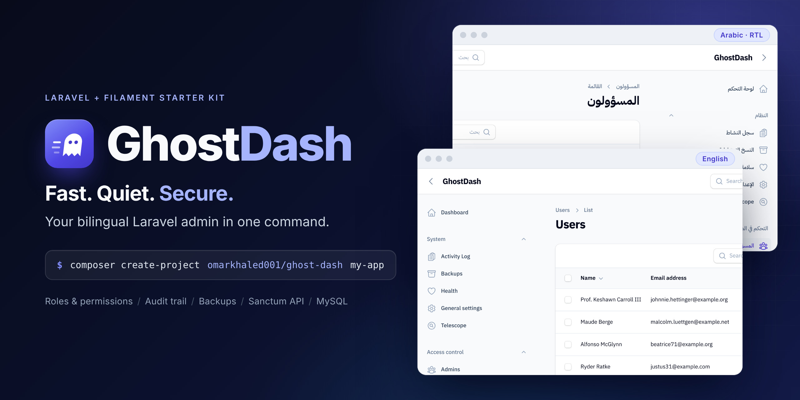

# GhostDash

> Fast. Quiet. Secure. Your bilingual Laravel admin in one command.

GhostDash is a production-grade Laravel + Filament starter kit: a bilingual (Arabic / English, RTL-aware) admin panel with roles and permissions, an audit trail, backups, health checks and a versioned Sanctum API for your end users, all on MySQL.

It is a skeleton application, not a package. You create a project from it and the code is yours.

| | |
|---|---|
| Composer package | `omarkhaled001/ghost-dash` |
| Repository | `omarkhaled001/ghost-dash` |
| Artisan namespace | `dash:*` |
| Kit-specific env prefix | `GHOSTDASH_*` |

## Contents

- [Requirements](#requirements)
- [Install](#install)
- [What you get](#what-you-get)
- [The installer: `dash:install`](#the-installer-dashinstall)
- [Other commands](#other-commands)
- [Composer scripts](#composer-scripts)
- [Environment variables](#environment-variables)
- [Admins, roles and permissions](#admins-roles-and-permissions)
- [Settings](#settings)
- [SEO](#seo)
- [User API](#user-api)
- [Scheduled tasks](#scheduled-tasks)
- [Directory layout](#directory-layout)
- [Testing](#testing)
- [Deployment](#deployment)
- [Optional packages](#optional-packages)

## Requirements

| Tool | Version | Notes |
|---|---|---|
| PHP | 8.4 or 8.5 | Extensions: `bcmath`, `ctype`, `curl`, `dom`, `fileinfo`, `intl`, `mbstring`, `openssl`, `pdo_mysql`, `tokenizer`, `xml`, `zip` |
| Composer | 2.x | |
| MySQL | 8.4 LTS | The only supported database. 8.0 works but is end-of-life and `dash:doctor` warns about it. |
| Node.js | 22 or newer, with npm | Builds the panel theme |
| git | any recent | |
| `mysql` / `mysqldump` client | matching the server | Only needed for backups. A missing client is a warning, not an error. |

## Install

### One command (recommended)

**macOS / Linux / WSL**

```bash
curl -fsSL https://raw.githubusercontent.com/omarkhaled001/ghost-dash/main/install.sh | bash -s -- my-app
```

**Windows (PowerShell 5.1 or 7)**

```powershell
irm https://raw.githubusercontent.com/omarkhaled001/ghost-dash/main/install.ps1 | iex
```

The Windows script asks for the project name. To skip the question, or to pass installer options, set them first:

```powershell
$env:GHOSTDASH_APP = 'my-app'
$env:GHOSTDASH_ARGS = '--create-db --no-git'
irm https://raw.githubusercontent.com/omarkhaled001/ghost-dash/main/install.ps1 | iex
```

Both scripts do the same four things:

1. Print the GhostDash version they will install.
2. Check PHP, the PHP extensions, Composer, Node.js, npm and git, and print the exact fix for your OS for anything missing. If PHP or Composer is missing they offer (y/N) to run the official [php.new](https://php.new) installer. Nothing is ever installed without your consent.
3. Run `composer create-project omarkhaled001/ghost-dash my-app`.
4. Hand over to `php artisan dash:install` inside the new directory.

Everything after the project name is passed to `dash:install`, so a fully unattended install looks like this:

```bash
curl -fsSL https://raw.githubusercontent.com/omarkhaled001/ghost-dash/main/install.sh | \
  GHOSTDASH_DB_PASSWORD=secret GHOSTDASH_ADMIN_PASSWORD='Str0ng-Passphrase!' bash -s -- my-app \
  --no-interaction --db-username=root --create-db \
  --admin-name="Omar" --admin-email=omar@example.com
```

If anything fails, the script stops, tells you why and prints the command to resume (`cd my-app && php artisan dash:install`). It never deletes your files.

| Script variable | Purpose |
|---|---|
| `GHOSTDASH_VERSION` | Version to install. Default: the latest stable tag. `dev-main` is allowed. |
| `GHOSTDASH_SOURCE` | Path to a local checkout of GhostDash. Installs from it through a Composer path repository instead of Packagist. Used by CI and when developing the kit. |
| `GHOSTDASH_APP` | (`install.ps1`) Project directory name. |
| `GHOSTDASH_ARGS` | (`install.ps1`) Options for `dash:install`, as one string. |

### With the Laravel installer

```bash
laravel new my-app --using=omarkhaled001/ghost-dash --database=mysql
cd my-app
php artisan dash:install
```

The Laravel installer runs a kit's hooks without a terminal attached, so GhostDash cannot ask its questions from inside it. It prints the second step instead, and you run it yourself.

Keep `--database=mysql`. Without it the Laravel installer assumes SQLite for starter kits and rewrites `.env` and `.env.example` accordingly. With it, the Laravel installer also runs `php artisan migrate` once, using the placeholder credentials from `.env.example`. That attempt normally fails quietly and is harmless either way: `dash:install` collects the real credentials and migrates again.

### With Composer

```bash
composer create-project omarkhaled001/ghost-dash my-app
```

In an interactive terminal, the installer starts by itself once Composer finishes. Otherwise it prints the next step:

```bash
cd my-app && php artisan dash:install
```

### From a git clone

```bash
git clone https://github.com/omarkhaled001/ghost-dash.git my-app
cd my-app
composer setup
```

`composer setup` runs `composer install` and then `php artisan dash:install`.

### After installing

```bash
composer dev
```

Open `http://localhost:8000/admin` and sign in with the super admin you created.

## What you get

**Admin panel** (Filament 5, at `/admin`)

- A separate `Admin` model on its own `admin` guard, with login, password reset, email verification, email-change verification and a profile page.
- Multi-factor authentication: authenticator app (TOTP) with recovery codes, and email codes.
- Inactive admins cannot sign in, and an admin who is deactivated while signed in is logged out on their next request.
- Roles and permissions (Filament Shield on top of spatie/laravel-permission) with generated policies for every resource, page and widget.
- Admin management with guard rails that hold even against a direct service call: see [Admins, roles and permissions](#admins-roles-and-permissions).
- A `Users` resource for your end users: find, view, create, edit (including marking an email address as verified) and delete them, each action behind its own permission.
- Arabic and English with a language switcher that remembers your choice. Arabic renders right-to-left.

**Operations**

- Activity log: who changed what, with before/after values, for admins, users, roles, permission changes and sign-in events on both guards. Sensitive values are redacted before they are stored.
- Backups: MySQL dump plus uploaded files, on a schedule, with a panel page to create, download and delete them.
- Health checks with a panel page.
- A tabbed Settings page: General (name, logo, favicon, language, time zone, contact email), Appearance (the panel's primary colour), Email (your own SMTP server, with a test send) and Socialite (sign-in with Google, Facebook, GitHub, X and LinkedIn for your users). Adding a tab of your own takes one command. See [Settings](#settings).
- SEO, switched on with one command: site-wide SEO and SEO per page in the panel's SEO menu, an `<x-seo>` component for page heads, and `GET /api/v1/seo` for a separate frontend. See [SEO](#seo).
- Laravel Telescope, loaded only when `TELESCOPE_ENABLED=true`. It is open in the `local` environment; everywhere else only admins holding `view_telescope` can open it. Passwords, tokens and other sensitive values are masked in what it records, wherever they sit in a request or response.

**User API**

- Sanctum token authentication for your end users under `/api/v1/auth/*`, with one JSON envelope for every response, including errors.

**Developer experience**

- `make:service`, `make:repository` and `make:settings-tab` generators that follow the kit's conventions.
- Pest, Larastan, Pint and Rector wired into one `composer check`.
- Two GitHub Actions workflows: `ci.yml` (`composer check` and `composer audit` on MySQL 8.4 with PHP 8.4 and 8.5) and `install-e2e.yml` (the one-command installer on Ubuntu and Windows). The second one tests the kit itself and is not copied into your project.
- Laravel Boost with generated AI guidelines.

## The installer: `dash:install`

```bash
php artisan dash:install
```

The installer is interactive by default, fully scriptable with options, and safe to run again: every step first checks whether it is already done, so after a failure you fix the cause, re-run the same command and it continues where it stopped.

| # | Step | What it does |
|---|---|---|
| 0 | Bootstrap | Creates `.env` from `.env.example` if missing and generates `APP_KEY` if empty. |
| 1 | App | Asks for the app name, URL and default language, and whether to switch on SEO, and writes them to `.env`. |
| 2 | Database | Asks for the MySQL connection, writes it to `.env` and tests it. Explains the usual failures (server not running, wrong credentials, missing database) and asks again. Offers to create a missing database. |
| 3 | Testing database | Creates `<database>_testing` and writes `.env.testing` with its own `APP_KEY`. |
| 4 | Schema and access | Runs migrations, `storage:link` and `dash:sync-permissions`, and stores the default settings. |
| 5 | Super admin | Creates the first super admin. Skipped when one already exists. |
| 6 | Demo data | Optional sample admins and users. Only in the `local` environment. |
| 7 | Assets | Runs `npm install` and `npm run build` when `public/build/manifest.json` is missing. |
| 8 | Git | Runs `git init` and makes the first commit when the directory is not a repository yet. |
| 9 | Summary | Runs `dash:doctor` and prints the panel URL, the admin email and the next commands. |

### Options

| Option | Description |
|---|---|
| `--app-name=` | Application name. Default: the directory name. |
| `--app-url=` | Application URL. Default: `http://localhost:8000`, or `http://<directory>.test` when Herd or Valet is detected. |
| `--locale=` | Default language, `en` or `ar`. Default: `en`. |
| `--db-host=` | MySQL host. Default: `127.0.0.1`. |
| `--db-port=` | MySQL port. Default: `3306`. |
| `--db-database=` | Database name. Default: the directory name in snake_case. |
| `--db-username=` | MySQL user. Default: `root`. |
| `--db-password=` | MySQL password. Prefer the `GHOSTDASH_DB_PASSWORD` environment variable, which keeps it out of your shell history. |
| `--create-db` | Create the database (and the testing database) when missing, without asking. |
| `--skip-testing-db` | Skip step 3. |
| `--admin-name=` | Name of the first super admin. |
| `--admin-email=` | Email of the first super admin. |
| `--admin-password=` | Password of the first super admin. Prefer the `GHOSTDASH_ADMIN_PASSWORD` environment variable. |
| `--demo` | Seed demo data. Refused outside the `local` environment. |
| `--seo` | Switch on SEO (`GHOSTDASH_SEO=true`). Interactive installs ask instead, defaulting to no. In production with `--no-interaction` the server's environment decides. |
| `--skip-assets` | Skip step 7. |
| `--no-git` | Skip step 8. |
| `--serve` | Start `composer dev` when the installer finishes. |
| `--no-serve` | Do not offer to start the development server. |
| `--testing-db`, `--assets`, `--git` | In production with `--no-interaction` these three steps are skipped. Each flag turns its step back on. |
| `-n`, `--no-interaction` | Never ask. Missing values fall back to the existing `.env` values, then to the defaults above. The admin name, email and password must be supplied when no super admin exists yet. |

Existing `.env` values are always offered as the defaults, so re-running the installer does not lose what you entered before.

### On a production server

```bash
php artisan dash:install --no-interaction --skip-testing-db --skip-assets --no-git
```

In the `production` environment with `--no-interaction`, the installer keeps the `.env` values you deployed (options such as `--app-name` and `--db-database` are ignored) and does not build assets, touch git or create a testing database unless you pass `--assets`, `--git` or `--testing-db`. Demo data is refused. The installer never writes policies or any other source file, so it is safe to run on a server.

## Other commands

| Command | Purpose |
|---|---|
| `php artisan dash:install` | The installer described above. |
| `php artisan dash:sync-permissions` | Creates any missing permissions for every panel resource, page and widget plus the custom permissions, all on the `admin` guard, gives all of them to `super_admin` and resets the permission cache. Idempotent, writes no files, safe in production. **Run it on every deployment.** |
| `php artisan dash:doctor` | Checks the installation and prints pass, warn or fail per check. Exits with code 1 when any check fails. |
| `php artisan make:service Billing/InvoiceService` | Creates a final, strictly typed service class in `app/Services`. |
| `php artisan make:repository Invoice` | Creates `app/Repositories/Contracts/InvoiceRepository.php` (interface), `app/Repositories/Eloquent/EloquentInvoiceRepository.php` (implementation) and registers the binding in `RepositoryServiceProvider`. Use `--model=` when the model name differs. |
| `php artisan make:settings-tab Shipping` | Creates a tab on the Settings page: `app/Settings/ShippingSettings.php`, `app/Filament/Settings/Tabs/ShippingTab.php`, a settings migration and `lang/{en,ar}/settings/shipping.php`. See [Settings](#settings). |
| `php artisan dash:seo` | Switches SEO on (`GHOSTDASH_SEO=true` in `.env`); `--disable` switches it off again and keeps what was entered. Refused in production, where the server's environment decides. See [SEO](#seo). |

### What `dash:doctor` checks

| Check | Fails when | Warns when |
|---|---|---|
| PHP version | below 8.4 | |
| PHP extensions | a required extension is missing | |
| `APP_KEY` | empty | |
| `APP_DEBUG` | on in production | |
| `APP_ENV` | | not `production` while `APP_URL` looks like a public address |
| Host names | | `APP_URL` is a development address outside `local`, where only its host is answered |
| Database connection | MySQL cannot be reached | |
| MySQL version | | below 8.4, or MariaDB |
| Scheduler | no heartbeat, in production | no heartbeat, elsewhere |
| Queue worker | no heartbeat, in production | no heartbeat, elsewhere |
| Telescope | | enabled outside `local` (it is gated, but still recording) |
| `mysqldump` | | not found |
| Backup disk | not reachable or not writable | |
| Storage link | | `public/storage` missing |

Heartbeat checks are warnings outside production, because nothing is running right after an install. The doctor cannot know whether a machine is a server, so for `APP_ENV` it looks at `APP_URL`: `localhost`, `127.0.0.1` and `.test` / `.local` names are treated as development machines.

## Composer scripts

| Script | What it runs |
|---|---|
| `composer setup` | `composer install`, then `php artisan dash:install`. For git clones. |
| `composer dev` | `php artisan dev`: the web server, a queue worker, the log tail and Vite, together. |
| `composer lint` | Pint, fixing files. |
| `composer lint:check` | Pint in `--test` mode. |
| `composer refactor` | Rector, changing files. |
| `composer refactor:check` | Rector in `--dry-run` mode. |
| `composer analyse` | Larastan (PHPStan), no baseline. |
| `composer test` | Pest, in parallel, against the MySQL testing database. |
| `composer check` | `lint:check`, `refactor:check`, `analyse` and `test`. This is what CI runs. |

## Environment variables

Standard Laravel variables keep their meaning. These are the ones GhostDash adds or relies on.

| Variable | Default | Purpose |
|---|---|---|
| `ADMIN_PANEL_PATH` | `admin` | URL path of the panel. |
| `FRONTEND_URL` | `http://localhost:3000` | Where your end-user frontend lives. API password reset links point to `FRONTEND_URL/reset-password?token=...&email=...`. |
| `DB_CONNECTION` | `mysql` | Must stay `mysql`. |
| `DB_HOST`, `DB_PORT`, `DB_DATABASE`, `DB_USERNAME`, `DB_PASSWORD` | `127.0.0.1`, `3306`, `my_app`, `root`, empty | MySQL connection. |
| `DB_CHARSET`, `DB_COLLATION` | `utf8mb4`, `utf8mb4_unicode_ci` | |
| `DB_DUMP_BINARY_PATH` | empty | Directory containing `mysqldump`, when it is not on `PATH`. |
| `SESSION_DRIVER`, `CACHE_STORE`, `QUEUE_CONNECTION` | `database` | All three use MySQL by default. |
| `TRUSTED_PROXIES` | empty | Addresses or ranges of the load balancer or reverse proxy in front of the app, comma-separated, such as `10.0.0.0/8`. Without it, forwarded headers are ignored and every request behind a proxy appears to come from the proxy. Avoid `*` unless your proxy overwrites `X-Forwarded-For`: with a proxy that appends to it, `*` lets a client choose the address it is rate limited by. |
| `TRUSTED_HOSTS` | empty | Outside `local`, requests are only answered for the host in `APP_URL` and its subdomains; any other `Host` header gets a 400. List further host names here as comma-separated regular expressions, for example `^api\.example\.org$`, or `^10\.` for a load balancer that health-checks by private address. |
| `SANCTUM_TOKEN_EXPIRATION` | `1440` | Lifetime of API tokens, in minutes. |
| `TELESCOPE_ENABLED` | `true` | Telescope is not loaded at all unless this is `true`. Set it to `false` in production. |
| `ACTIVITYLOG_RETENTION_DAYS` | `365` | Activity older than this is deleted nightly. |
| `GHOSTDASH_SEO` | `false` | Switches on SEO: the SEO menu, `<x-seo>` and `GET /api/v1/seo`. Set by `dash:seo`. |
| `BACKUP_DISK` | `backups` | Filesystem disk that receives backups. `backups` is a private local disk at `storage/app/backups`. |
| `BACKUP_NOTIFICATION_EMAIL` | empty | Address that is told when a backup succeeded, failed, is missing or too old, or could not be cleaned up. No mail is sent while it is empty. |
| `BACKUP_ARCHIVE_PASSWORD` | empty | When set, backup archives are encrypted with this password. Keep a copy somewhere other than the server. |
| `HEALTH_NOTIFICATIONS_ENABLED`, `HEALTH_TO_ADDRESS` | `false`, empty | Mail failing health checks to this address. Off by default: the Health page and `dash:doctor` show the same results. |

Variables read only by the installer, never stored:

| Variable | Purpose |
|---|---|
| `GHOSTDASH_DB_PASSWORD` | MySQL password for `dash:install`. |
| `GHOSTDASH_ADMIN_PASSWORD` | Password of the first super admin for `dash:install`. |
| `GHOSTDASH_SKIP_AUTO_INSTALL` | Set to `1` to stop `composer create-project` from starting `dash:install` by itself. The bootstrap scripts set it because they start the installer themselves. |
| `GHOSTDASH_VERSION`, `GHOSTDASH_SOURCE`, `GHOSTDASH_APP`, `GHOSTDASH_ARGS` | Read by `install.sh` / `install.ps1`, see [Install](#install). |

## Admins, roles and permissions

Admins and end users are different people in different tables.

| | Admins | Users |
|---|---|---|
| Model | `App\Models\Admin` | `App\Models\User` |
| Table | `admins` | `users` |
| Guard | `admin` (session) | `web` (session), `sanctum` (API tokens) |
| Password broker | `admins` | `users` |
| Signs in at | the panel | your frontend, through the API |

Roles and permissions belong to the `admin` guard. `super_admin` holds every permission.

**Guard rails.** These are enforced in the policies and in `AdminService` and `RoleService`, not only by hiding buttons:

- Nobody can delete or deactivate their own account.
- The last active `super_admin` cannot be deleted, deactivated or demoted.
- Only a `super_admin` can create or edit a `super_admin`, or assign that role.
- Admins who are not `super_admin` cannot see `super_admin` accounts at all: not in the Admins resource, and not in the activity log, where everything done by or to a super admin is left out for them.
- The `super_admin` role itself cannot be renamed, edited or deleted, and a role that is still assigned to someone cannot be deleted.
- Nobody can give a role a permission they do not hold themselves.
- Nobody can assign a role that carries a permission they lack, to themselves or anyone else, and nobody can edit, deactivate or delete an admin who holds a permission they lack. Being allowed to edit admins is therefore never a way to gain access.

**Custom permissions** for features that are not resources:

| Permission | Grants |
|---|---|
| `view_telescope` | Opening Telescope |
| `view_activity_log` | The activity log and record timelines |
| `manage_settings` | The Settings page. A tab can ask for a further permission on top. |
| `manage_backups` | The Backups page: list, create, download, delete. An archive contains the whole database, password hashes included, so give this only to people you would trust with all of it, and consider `BACKUP_ARCHIVE_PASSWORD`. |
| `view_health` | The Health page |
| `manage_seo` | Site SEO, when SEO is switched on. SEO per page has the usual resource permissions (`view_any:seo_page`, ...). |

After adding a resource, page or widget, generate its policy while developing and commit it:

```bash
php artisan shield:generate --all --panel=admin --option=policies
php artisan dash:sync-permissions
```

Servers only ever run `dash:sync-permissions`, which touches the database and nothing else.

## Settings

The Settings page (`/admin/settings`, permission `manage_settings`) shows one tab per settings group. Every value is stored with [spatie/laravel-settings](https://github.com/spatie/laravel-settings), every change is written to the activity log with before and after values, and the tab is kept in the URL (`?tab=mail`).

| Tab | Holds | Settings class |
|---|---|---|
| General | App name, logo, favicon, default language, time zone, contact email | `App\Settings\GeneralSettings` |
| Appearance | The panel's primary colour | `App\Settings\AppearanceSettings` |
| Email | Whether to send with these settings instead of `.env`, SMTP server, port, encryption, username, password, from address and name. **Send a test email** tries the values in the form, saved or not. | `App\Settings\MailSettings` |
| Socialite | Per provider (Google, Facebook, GitHub, X, LinkedIn): on or off, client ID, client secret | `App\Settings\SocialiteSettings` |

Read a value anywhere with the container: `resolve(MailSettings::class)->from_address`.

**Secrets** (the SMTP password and the client secrets) are stored encrypted with `APP_KEY`, never sent back to the browser, and masked in the activity log. Leaving such a field empty keeps the stored value.

**Email.** While the switch is off, mail goes out as configured in `.env`. Switched on, these values replace it wherever mail is sent: web requests, queue workers and commands. A running queue worker picks up a change after `php artisan queue:restart`.

**Socialite.** End users sign in with a provider through the API: your app obtains an access token from the provider and sends it to `POST /api/v1/auth/social/{provider}` (see [User API](#user-api)). A provider is offered only when it is switched on and has both credentials; `GET /api/v1/settings` lists the ready ones under `socialite.providers`, so an app knows which buttons to show.

### Adding a tab

```bash
php artisan make:settings-tab Shipping
```

That writes four things, then you run `php artisan migrate`:

1. `app/Settings/ShippingSettings.php`: one public property per setting.
2. A migration in `database/settings/` that adds each property with its default.
3. `app/Filament/Settings/Tabs/ShippingTab.php`: the form fields, label, icon, position (`sort()`), optionally a narrower `permission()`, and `secrets()` for values that must not reach the browser.
4. `lang/en/settings/shipping.php` and `lang/ar/settings/shipping.php`. The Arabic file starts out in English.

Nothing is registered by hand: every tab in `app/Filament/Settings/Tabs` appears on the page by itself. A tab that lives elsewhere, in a package for instance, goes in `config/ghostdash.php` under `settings.tabs`.

Adding a setting to an existing tab is the same three edits: a property, a line in a new settings migration (`$this->migrator->add('shipping.free_above', 500)`), and a field in the tab.

To make a group readable without signing in, implement `App\Settings\Contracts\PublicSettings` on its settings class. `toPublicArray()` decides exactly what leaves the server.

## SEO

Off until you switch it on:

```bash
php artisan dash:seo
```

or `php artisan dash:install --seo`. On a server, set `GHOSTDASH_SEO=true` in its environment. The panel then has an **SEO** menu with two entries:

| Entry | What it is | Permission |
|---|---|---|
| Site SEO | The defaults for every page: site name and title separator, description, keywords, sharing image, X account, whether search engines may index and follow, the Google Search Console and Bing verification codes, and Google Analytics or Tag Manager | `manage_seo` |
| Pages | A resource with one record per page of your website, by path (`/`, `/about`, `/pricing`): title, description, keywords, sharing image, canonical URL, and index/follow, each falling back to the site-wide value when empty | `view_any:seo_page`, `create:seo_page`, and so on |

Paths are stored one way: `about`, `/about/` and `/about?ref=x` are all `/about`. Every change to a page is in the activity log.

In a Blade layout:

```blade
<head>
    <x-seo />
</head>
```

`<x-seo />` looks up the current path and writes the title (`About | Acme`), description, keywords, robots, canonical link, Open Graph and X (Twitter) cards, the verification tags, and the Google Analytics or Tag Manager snippet, each only when it is filled in. Attributes win over what is stored: `<x-seo title="Checkout" description="..." image="..." canonical="..." type="article" />`. With SEO off it renders nothing, so a layout can include it either way.

A separate frontend asks the API for the same values: `GET /api/v1/seo?path=/about`.

## User API

Base path: `/api/v1`. Send `Accept: application/json`. Authenticated routes take `Authorization: Bearer <token>`. Send `Accept-Language: ar` or `en` to choose the language of messages and validation errors.

### Endpoints

| Method | Path | Auth | Rate limit | Purpose |
|---|---|---|---|---|
| POST | `/api/v1/auth/register` | none | 5 / minute per IP | Create an account, returns a token |
| POST | `/api/v1/auth/login` | none | 5 / minute per email + IP, and 20 / minute per IP | Exchange credentials for a token |
| POST | `/api/v1/auth/forgot-password` | none | 3 / minute per email + IP, and 10 / minute per IP | Email a password reset link |
| POST | `/api/v1/auth/reset-password` | none | 5 / minute per IP | Set a new password with a reset token; revokes all tokens |
| GET | `/api/v1/auth/verify-email/{id}/{hash}` | signed URL | 6 / minute per IP | Confirm an email address |
| POST | `/api/v1/auth/email/verification-notification` | token | 3 / minute per user | Resend the verification email |
| GET | `/api/v1/auth/me` | token | 60 / minute per user | The authenticated user |
| PUT | `/api/v1/auth/password` | token | 5 / minute per user | Change the password; revokes the other tokens |
| POST | `/api/v1/auth/logout` | token | 30 / minute per user | Revoke the current token |
| POST | `/api/v1/auth/logout-all` | token | 10 / minute per user | Revoke every token of the user |
| POST | `/api/v1/auth/social/{provider}` | none | 10 / minute per IP | Sign in or sign up with a provider's access token (`google`, `facebook`, `github`, `x`, `linkedin`) |
| GET | `/api/v1/settings` | none | 120 / minute per IP | The public settings: `general`, `appearance` and `socialite` (the providers that are ready) |
| GET | `/api/v1/seo?path=/about` | none | 120 / minute per IP | The resolved SEO for one page. 404 while SEO is off. |

Each endpoint has its own named rate limiter (`auth.register`, `auth.login`, `settings`, and so on), defined in `app/Providers/ApiServiceProvider.php`.

`GET /api/v1/settings` returns only what each settings class chooses to make public: file paths become full URLs, and empty social networks are left out.

### Social sign-in

Your app signs the person in with the provider's own SDK, then exchanges the provider's access token for one of ours:

```http
POST /api/v1/auth/social/google
{"access_token": "ya29.a0A...", "device_name": "iPhone"}
```

The answer is the same as for `login` (201 when the account was just created). GhostDash asks the provider who the token belongs to and trusts nothing else the client sends. The first sign-in links the provider account to the user; later sign-ins find them through it.

When an account with the same email address already exists, it is joined only if the provider has confirmed the address belongs to the person (Google and LinkedIn say so per address; GitHub and Facebook only return confirmed ones). Otherwise the answer is 422 and the person signs in with their password, so that nobody can take over an account by opening a provider account under someone else's address. A new account's address counts as verified on the same terms; otherwise the usual verification email is sent.

### Tokens

`register` and `login` return a plain-text token once. Tokens carry abilities and expire after `SANCTUM_TOKEN_EXPIRATION` minutes. Changing or resetting a password revokes them, also when an admin sets the password in the panel.

| Ability | Needed for |
|---|---|
| `account:read` | `GET /auth/me` |
| `account:write` | `PUT /auth/password`, `POST /auth/email/verification-notification`, `POST /auth/logout-all` |

`register` and `login` accept an optional `device_name`, which becomes the name of the token. `login` also accepts an optional `abilities` array to request a narrower token. Asking for an ability that does not exist is a validation error.

`logout` needs no ability: any token can revoke itself.

### Response envelope

Every response, success or error, has the same four keys.

Success:

```json
{
    "success": true,
    "message": "Signed in.",
    "data": {
        "user": {
            "id": 1,
            "name": "Omar",
            "email": "omar@example.com",
            "email_verified_at": "2026-11-15T10:00:00+00:00",
            "created_at": "2026-11-15T10:00:00+00:00"
        },
        "token": "1|Jq0...",
        "token_type": "Bearer",
        "abilities": ["account:read", "account:write"],
        "expires_at": "2026-11-16T10:00:00+00:00"
    },
    "errors": null
}
```

Error:

```json
{
    "success": false,
    "message": "The given data was invalid.",
    "data": null,
    "errors": {
        "email": ["The email field is required."]
    }
}
```

| Status | When | `errors` |
|---|---|---|
| 200, 201 | Success | `null` |
| 401 | Missing, invalid, expired or revoked token | `null` |
| 403 | Authenticated but not allowed, token lacks the ability, or invalid signed URL | `null` |
| 404 | Unknown route or record | `null` |
| 405 | Wrong HTTP method | `null` |
| 422 | Validation failed, including wrong credentials | object of field → messages |
| 429 | Rate limited. `Retry-After` header is set. | `null` |
| 500 | Unexpected error. The message is generic unless `APP_DEBUG=true`. | `null` |

Two optional keys can appear next to the four: collections add `meta` with pagination details, and a 500 adds `debug` (exception class, file and line) while `APP_DEBUG=true`, never otherwise.

## Scheduled tasks

All scheduled tasks live in `routes/console.php`. Add one cron entry on the server:

```cron
* * * * * cd /path/to/app && php artisan schedule:run >> /dev/null 2>&1
```

| Task | When | Purpose |
|---|---|---|
| `health:schedule-check-heartbeat` | every minute | Proves the scheduler runs |
| `health:queue-check-heartbeat` | every minute | Proves a queue worker runs |
| `health:check` | every minute | Runs the health checks and stores the results |
| `sanctum:prune-expired --hours=24` | daily 00:30 | Deletes API tokens that expired more than a day ago |
| `auth:clear-resets users`, `auth:clear-resets admins` | daily 00:45 | Deletes expired password reset tokens of both password brokers |
| `backup:clean` | daily 01:00 | Removes old backups according to the retention policy |
| `backup:run` | daily 01:30 | MySQL dump plus `storage/app/public` |
| `backup:monitor` | daily 03:00 | Notifies when backups are missing or too old |
| `activitylog:clean --force --days=<ACTIVITYLOG_RETENTION_DAYS>` | daily 02:00 | Deletes old activity |
| `telescope:prune --hours=48` | daily 02:15 | Only when Telescope is enabled |
| `model:prune` (health history) | daily 02:30 | Deletes health results older than 5 days |

## Directory layout

```
app/
├── Actions/ActivityLog/       Custom activity-log actions (redaction)
├── Console/Commands/          dash:install, dash:doctor, dash:sync-permissions, make:service, make:repository
├── Data/                      Small immutable value objects passed between layers
├── Enums/                     Backed enums
├── Exceptions/                Guard-rail and installer exceptions, the API exception renderer
├── Filament/
│   ├── Concerns/, Contracts/  Permission gate for pages that are not resources
│   ├── Pages/                 Settings, Site SEO, Backups, Health, auth pages
│   ├── Settings/              The settings tab base class; Tabs/ holds one class per tab
│   ├── RelationManagers/      Activity timeline, reusable on any resource
│   ├── Resources/             Admins, Users, Roles, Activities, SEO pages
│   ├── Support/               Helpers shared by resources
│   └── Widgets/
├── Health/                    Custom health checks
├── Http/
│   ├── Controllers/Api/V1/    Thin API controllers
│   ├── Middleware/            SecurityHeaders, EnsureAdminIsActive, SetLocaleFromHeader, ApplyGeneralSettings, RedirectTelescopeGuestsToLogin
│   ├── Requests/Api/V1/       Form Requests
│   └── Resources/Api/V1/      API Resources
├── Jobs/                      Queued backup run
├── Listeners/                 Auth event logging, last login, remembered language
├── Mail/                      The test email from the Email settings tab
├── Models/                    Admin, User, Role, Permission, Activity, SeoPage, SocialAccount
├── Notifications/Api/         Verification and password reset mails for API users
├── Policies/                  One policy per resource
├── Providers/                 App, Api, Repository, Telescope and the Filament panel provider
├── Repositories/
│   ├── Contracts/             Interfaces
│   └── Eloquent/              Eloquent implementations
├── Services/                  Business logic. Resources and controllers call these for writes.
├── Settings/                  spatie/laravel-settings classes: one per tab, plus site-wide SEO
├── Support/                   Small helpers (API responses, redaction of sensitive values, installer steps)
└── View/Components/           <x-seo>
config/ghostdash.php           Kit configuration
database/settings/             Settings migrations
lang/{en,ar}/                  Translations; settings/ has one file per settings tab
routes/api.php                 /api/v1 routes
routes/console.php             Every scheduled task
stubs/                         Stubs for make:service, make:repository, make:settings-tab and Laravel's own generators
tests/
├── Arch/                      Architecture rules
├── Feature/, Unit/
└── Installer/                 Runs dash:install for real, into scratch databases
.ai/guidelines/                The kit's conventions, fed to Laravel Boost (AGENTS.md is generated from them)
install.sh, install.ps1        One-command bootstrap scripts. Kit repository only: not copied into new projects.
```

**Conventions**

- `declare(strict_types=1)` everywhere, full type declarations, classes are `final` unless they are meant to be extended.
- Business logic lives in a service. Data access goes through a repository interface bound in `RepositoryServiceProvider`. `Admin` and `User` are the reference implementations.
- Statuses and other closed sets are backed enums.
- Every user-facing string goes through `__()` and exists in `lang/en` and `lang/ar`.

## Testing

Tests run against a real MySQL database. `dash:install` creates it and writes `.env.testing`. To do it by hand:

```bash
cp .env.testing.example .env.testing
php artisan key:generate --env=testing
mysql -e "CREATE DATABASE my_app_testing CHARACTER SET utf8mb4 COLLATE utf8mb4_unicode_ci"
composer test
```

The suite refuses to start when the configured database name does not contain `_testing`, so a missing `.env.testing` can never wipe your development data.

`composer test` runs in parallel. Laravel creates one database per process, named `<DB_DATABASE>_test_<n>`, so the MySQL user needs permission to create them:

```sql
GRANT ALL PRIVILEGES ON `my_app_testing%`.* TO 'my_user'@'localhost';
```

The `Installer` suite runs `dash:install` for real. It creates scratch databases named `<testing database>_it_<random>` and drops them afterwards, which the same grant covers.

Run a single file without parallelism with `vendor/bin/pest tests/Feature/SomeTest.php`.

## Deployment

```bash
composer install --no-dev --optimize-autoloader
npm ci && npm run build
php artisan migrate --force
php artisan dash:sync-permissions
php artisan optimize
php artisan filament:optimize
php artisan queue:restart
```

**Production checklist**

- [ ] `APP_ENV=production`, `APP_DEBUG=false`
- [ ] `TELESCOPE_ENABLED=false`
- [ ] `APP_URL` uses `https://` (GhostDash forces HTTPS URLs and sends HSTS in production)
- [ ] `SESSION_SECURE_COOKIE=true`, so the session cookie is never sent over plain HTTP
- [ ] `APP_URL` is the address people really use. Outside `local` the app answers only for that host, its subdomains and `TRUSTED_HOSTS`, so that a forged `Host` header cannot end up in a password reset link.
- [ ] `TRUSTED_PROXIES` set to the addresses of the load balancer or reverse proxy, when there is one. The API rate limits and the recorded sign-in address depend on it. The proxy has to pass the original host name on, as `Host` or as `X-Forwarded-Host`.
- [ ] A real mailer instead of `MAIL_MAILER=log`
- [ ] `BACKUP_NOTIFICATION_EMAIL` set, and `BACKUP_DISK` pointing at off-server storage
- [ ] The scheduler cron entry is installed and a queue worker is supervised
- [ ] `php artisan dash:doctor` passes

To debug production with Telescope, set `TELESCOPE_ENABLED=true`, run `php artisan optimize`, and switch it back off when you are done. Outside `local` it records only exceptions, failed requests, failed jobs, slow queries and tagged entries, and only admins with `view_telescope` can open it.

## Optional packages

Not installed by default. Add them when a project needs them.

| Package | Use it for |
|---|---|
| [Laravel Horizon](https://laravel.com/docs/horizon) | Redis queues with a dashboard. Switch `QUEUE_CONNECTION` to `redis`. |
| [Laravel Pulse](https://laravel.com/docs/pulse) | Application performance at a glance. |
| [Laravel Reverb](https://laravel.com/docs/reverb) | WebSockets. |
| [spatie/laravel-medialibrary](https://spatie.be/docs/laravel-medialibrary) | File attachments on models, with conversions. |
| [Sentry](https://docs.sentry.io/platforms/php/guides/laravel/) | Error tracking. |

## License

MIT.
