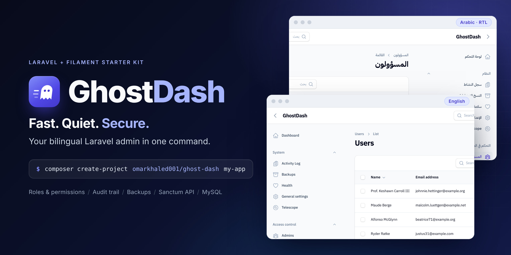

**Fast. Quiet. Secure. Your bilingual Laravel admin in one command.**

The first release of GhostDash: a Laravel 13 + Filament 5 starter kit with an Arabic / English (RTL) admin panel, roles and permissions, an audit trail, backups, health checks and a Sanctum API for your end users, all on MySQL 8.4.

It is a skeleton application, not a package. You create a project from it and the code is yours.

## Install

**macOS / Linux / WSL**

```bash
curl -fsSL https://raw.githubusercontent.com/omarkhaled001/ghost-dash/main/install.sh | bash -s -- my-app
```

**Windows (PowerShell 5.1 or 7)**

```powershell
irm https://raw.githubusercontent.com/omarkhaled001/ghost-dash/main/install.ps1 | iex
```

**Composer**

```bash
composer create-project omarkhaled001/ghost-dash my-app
```

**Laravel installer**

```bash
laravel new my-app --using=omarkhaled001/ghost-dash --database=mysql
cd my-app && php artisan dash:install
```

**Git clone**

```bash
git clone https://github.com/OmarKhaled001/ghost-dash.git my-app
cd my-app && composer setup
```

Requirements: PHP 8.4 or 8.5, Composer 2, MySQL 8.4, Node.js 22+, git.

## What's in 1.0.0

### Admin panel
- A separate `Admin` model on its own `admin` guard: login, password reset, email verification, email-change verification and a profile page.
- Multi-factor authentication with an authenticator app (with recovery codes) or email codes.
- Inactive admins cannot sign in, and are signed out on their next request when deactivated.
- Arabic and English with a language switcher that remembers each admin's choice. Arabic renders right to left.
- Resources for admins, roles, users and the activity log, plus pages for backups, health checks and general settings (name, logo, favicon, language, time zone).

### Roles, permissions and guard rails
- Filament Shield on spatie/laravel-permission, with a policy for every resource and page.
- Custom permissions: `view_telescope`, `view_activity_log`, `manage_settings`, `manage_backups`, `view_health`.
- Guard rails enforced in services and policies, not only by hiding buttons:
  - nobody can delete or deactivate themselves
  - the last active super admin cannot be removed or demoted
  - only a super admin can create, edit or assign super admins, and other admins cannot see them at all
  - nobody can grant, or take charge of, permissions they do not hold themselves

### Operations
- **Activity log:** who changed what, with before/after values, sign-in events for both guards, and sensitive values redacted before they are stored.
- **Backups:** scheduled MySQL dump plus uploaded files, cleanup and monitoring, with a page to create, download and delete archives.
- **Health checks:** database, cache, queue and scheduler heartbeats, disk space, and production settings.
- **Telescope:** loaded only when `TELESCOPE_ENABLED=true`, gated by `view_telescope` outside local, with passwords and tokens masked in everything it records.

### User API (`/api/v1/auth/*`)
- Register, login, logout, logout everywhere, profile, forgot / reset / change password, email verification.
- Tokens with abilities and an expiry, a named rate limiter per endpoint, and one JSON envelope for every response, errors included, in Arabic or English.

### Installer and tooling
- `php artisan dash:install`: interactive or fully unattended, safe to re-run, and resumes where it stopped after a failure.
- `php artisan dash:doctor` checks an installation; `php artisan dash:sync-permissions` keeps permissions in step on every deployment.
- `make:service` and `make:repository` generators, and Laravel's stubs republished with strict types and final classes.
- Pest, Larastan (no baseline), Pint and Rector in one `composer check`, plus Laravel Boost guidelines for AI agents.

## Verified for this release
- `composer check` (Pint, Rector, Larastan, 498 Pest tests) passes on PHP 8.4 and 8.5 against MySQL 8.4.
- The one-command installer is tested on every push on Ubuntu (bash), Windows (PowerShell 7) and Windows PowerShell 5.1: it installs a fresh project, serves the panel and signs the super admin in.
- The definition of done was checked in a real browser: Arabic RTL, a limited admin who sees only what they are allowed to, their changes in the activity log, Telescope gating, and a backup containing the MySQL dump.

## Known limitations
- `composer create-project` and the one-line installers need the package to be on Packagist. Until it is, use the git clone route.
- macOS / bash 3.2 has not been run yet; the script avoids bash 4 features.
- No Content-Security-Policy header is sent; add one per project.
- The API covers authentication only.

See [README.md](https://github.com/OmarKhaled001/ghost-dash/blob/v1.0.0/README.md) for the full reference, [DECISIONS.md](https://github.com/OmarKhaled001/ghost-dash/blob/v1.0.0/DECISIONS.md) for why things are the way they are, and [CHANGELOG.md](https://github.com/OmarKhaled001/ghost-dash/blob/v1.0.0/CHANGELOG.md) for the complete list.
